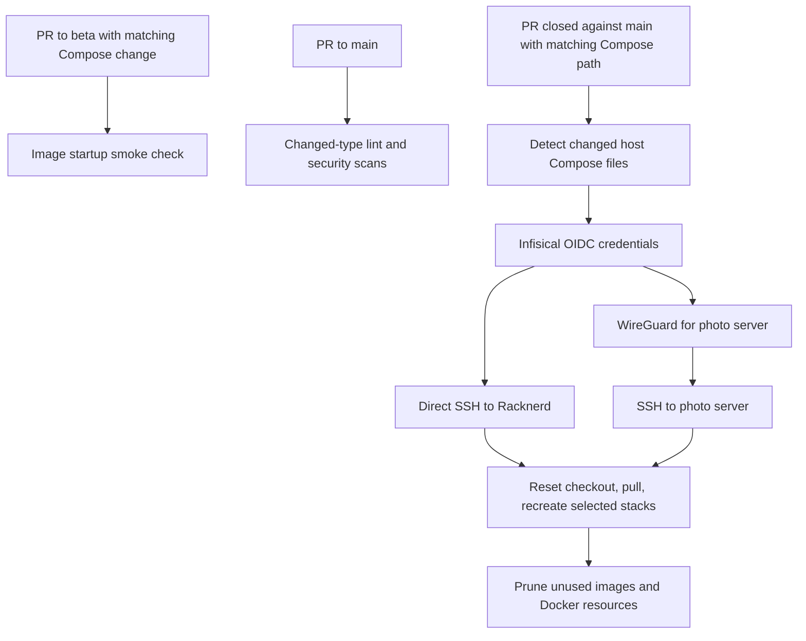

# Repository automation

[Repository overview](../README.md)

GitHub Actions validates configuration, plans/applies OpenTofu roots,
deploys selected Compose projects, and uploads security scan results.
Workflow YAML is the source of truth for exact actions, permissions,
environments, and credentials.

## Workflow map

| Workflow | Trigger | Behavior |
| --- | --- | --- |
| [Lint](workflows/lint.yml) | PRs to `main`/`beta`; pushes to `main` | Detects changed file types and runs relevant linters, including Markdown |
| [Docker compatibility](workflows/docker-compatibility.yml) | PRs to `beta` changing Racknerd/photo server `compose.yml` | Selects changed files, installs Python dependencies, and runs image smoke checks |
| [Docker deploy](workflows/deploy.yml) | Closed PRs to `main` matching those hosts' `compose.yml` | Finds changed stacks and recreates them over SSH |
| [Remote OpenTofu state](workflows/tf-state.yml) | PRs to `main`/`beta` and pushes to `main` touching `tf/**` or this workflow | Formats, detects provider changes, initializes, validates, plans, and applies on a push to `main` |
| [Trivy repository/images](workflows/trivy-scan.yml) | PRs/pushes to `main`, Monday 06:00 UTC, or manual dispatch | Repository filesystem, IaC, and conditionally Docker image scans |
| [Trivy hosts](workflows/trivy-host-scan.yml) | Monday 07:00 UTC or manual dispatch | Runs host filesystem scans on Racknerd and photo server and retrieves SARIF |

The lint workflow retains a `nix/**` filter and Nix lint job, although this
checkout has no `nix/` directory. Local [lint.sh](../scripts/lint.sh) does
not run Markdown lint or Nix checks; Markdown has a separate CI job.

## Compose delivery flow

Arrows show execution paths, not a guaranteed promotion sequence. The
workflow definitions do not require a `beta` PR before a `main` PR.
Deployment uses [diffs.sh](../scripts/diffs.sh), while compatibility uses
[diffs-no-merge.sh](../scripts/diffs-no-merge.sh). Remote deployment resets
tracked host changes and runs `up -d --force-recreate --remove-orphans`
for each selected Compose file.

Current deployment limits:

- The close trigger has no explicit `pull_request.merged` guard. Treat a
  closed unmerged PR as a possible trigger; changed-file detection still
  relies on merge history.
- Only Racknerd/photo server `compose.yml` changes trigger deployment.
  Mounted configuration, scripts, environment files, and Synology are
  outside that selection.
- Secrets fetched by deployment supply SSH and VPN connectivity. The
  workflow does not provision every stack's host-local `.env` file.
- A completed SSH command does not establish end-to-end application
  health or a tested database rollback.

## OpenTofu execution

Provider jobs use Infisical's `open-tofu` project with matching GitHub and
Infisical environment names. Each root configures an HTTP state backend,
validates, and writes a saved plan. Apply is conditional on a `push` event
to `refs/heads/main`. Concurrency groups serialize each provider root;
there is no cross-root dependency ordering.

The [OpenTofu overview](../tf/README.md) maps remote-state dependencies and
the Cloudflare/Authentik cycle. The Tailscale path filter currently uses
`tf/tailcale/**`, and Databasus has no provider job. Provider README changes
can select an existing root's job because filters cover whole directories.
CI uses WireGuard for Proxmox, UniFi, and Uptime Kuma private API access.

## Security reports and dependency updates

See [the scanning guide](../trivy/README.md) for scan scope, exclusions,
image filtering, and report limitations. The image job runs when Docker
paths change or on scheduled/manual runs. It extracts static image strings
across `docker/`, scans unique references, and combines SARIF reports.

[Renovate configuration](renovate.json) targets `beta`, enables weekly
lockfile maintenance, and includes a custom manager for `.opentofu-version`.
It also retains Nix rules for a tree that is currently absent. Dependency
PRs still require documentation review when behavior or prerequisites
change; see [the maintenance policy](../docs/documentation.md).

## Changing automation

Keep triggers, path filters, job conditions, environment names, OIDC
subjects, required permissions, and remote commands aligned. Review
[Infisical identity resources](../tf/infisical/README.md) when adding a
job environment. Validate changed shell/YAML and describe which event and
path combination exercises the intended job.

**Maintenance:** update this workflow map, flow diagram, and affected area
guides with every automation change. Follow
[the required checklist](../docs/documentation.md).
