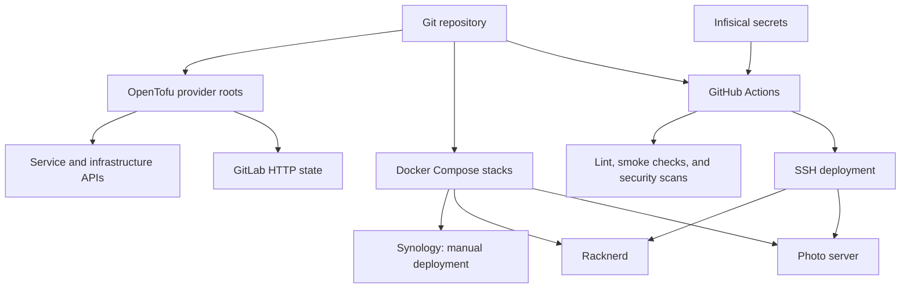

# Infrastructure

Configuration for self-hosted services, cloud resources, networking, and
operations. Docker Compose stacks are grouped by host; OpenTofu roots
manage the APIs that configure those services and their surrounding
infrastructure.

[](https://github.com/jnstockley/infrastructure/actions/workflows/deploy.yml)

## Start here

| Area | What you will find |
| --- | --- |
| [Docker](docker/README.md) | Stack layout, shared networks, deployment, and persistence |
| [Photo server](docker/photo-server/README.md) | On-premises applications, identity, photos, and DNS |
| [Racknerd](docker/racknerd/README.md) | Public server applications, VPN, mail, and backups |
| [Synology](docker/synology/README.md) | NAS monitoring agent |
| [OpenTofu](tf/README.md) | Provider roots, remote state, dependencies, and planning |
| [Automation](.github/README.md) | GitHub Actions triggers, deployment behavior, and Renovate |
| [Scripts](scripts/README.md) | Local linting, change detection, SSH, and maintenance helpers |
| [Tests](tests/README.md) | Container image smoke checks and their limits |
| [Security scanning](trivy/README.md) | Repository, image, and host scans |
| [Host services](services/README.md) | Databasus verification agent systemd unit |
| [Operations documentation](docs/README.md) | Runbook index and documentation maintenance rules |

## How the pieces fit



The diagram separates stored configuration from automation. A checked-in
stack or resource is a desired configuration, not proof that it is running.
See the area documentation for workflow coverage and manual prerequisites.

## Working locally

Use Python 3.14 with `uv`; install the tools required by
[scripts/lint.sh](scripts/lint.sh) separately. The lint suite includes YAML,
Compose, shell, Python, and OpenTofu formatting checks.

```bash
uv sync
bash scripts/lint.sh
```

For a Compose change, supply the stack's host-local environment first:

```bash
docker compose -f docker/photo-server/immich/compose.yml config --quiet
FILES=docker/photo-server/immich/compose.yml uv run pytest tests/test_containers.py
```

The pytest command needs a Docker daemon and checks a selected image's
startup; it does not validate the full application. See
[the testing guide](tests/README.md). For infrastructure changes, use the
[OpenTofu workflow](tf/README.md) and review the plan before applying.

## Required documentation maintenance

**Every change must include a documentation review. Update affected
READMEs, runbooks, inventories, and diagrams in the same change.**
[AGENTS.md](AGENTS.md) makes this a required completion step for AI agents;
[the maintenance guide](docs/documentation.md) maps paths to documents and
explains what to check. For changes with no documentation impact, record
what was reviewed and why no edit was needed in the handoff or PR.

Store secret values in the approved secret store or host-local environment
files. Document variable names and provisioning steps, never credentials.

## Existing follow-ups

- Complete the migration to Infisical on hosts.
- Update the Databasus healthcheck as needed.
- Finish Arcane agent setup.

These are carried forward from the previous README; configuration in this
repository does not establish whether the operational work is complete.
