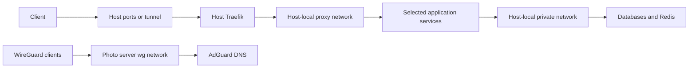

# Docker Compose stacks

[Repository overview](../README.md)

Each host directory contains independent service projects. A typical stack
has a `compose.yml`, an optional `sample.env`, and local configuration or
persistent directories. There is no top-level Compose project that starts
all hosts or services together.

## Hosts

| Host | Responsibility | Deployment coverage |
| --- | --- | --- |
| [Photo server](photo-server/README.md) | On-premises applications, identity, DNS, and storage | SSH through a CI WireGuard connection |
| [Racknerd](racknerd/README.md) | Public services, VPN, mail, and backup storage | Direct SSH from CI |
| [Synology](synology/README.md) | Beszel NAS monitoring | Manual; excluded from deployment and image smoke-test paths |

## Networking



Arrows show typical traffic paths. `proxy` and `private` are external
Docker networks shared between projects **on the same host**. Identical
names on different hosts do not connect them. External networks must exist
before a stack starts; Compose does not create them. Several declarations
label `private` as internal, but the actual pre-existing network determines
its isolation and addressing.

Photo server also uses `wg`, AIO-related networks, and a Tailscale sidecar.
Some services use host networking or project-local networks. Read the
host guide and exact Compose file before changing connectivity.

## Configure and validate a stack

### Stack integration checklist

Complete these checks when adding a stack or adding/renaming services.
Add the applicable configuration in the same change as the Compose files;
checking for a gap without implementing the integration is not completion.
Respect explicit user exclusions and deferrals. Explain blocked or
inapplicable items in the handoff or PR rather than adding per-service
checklist results to READMEs.

#### Uptime Kuma

1. Inventory the stack's long-running containers, including workers,
   database helpers, and networking sidecars. Add a Docker monitor for each
   container in [the Uptime Kuma root](../tf/uptime-kuma/README.md), reusing
   existing monitors where appropriate. Skip one-shot initialization,
   migration, and tools-profile jobs; explain any other exclusions.
2. Match the monitor's provider alias and Docker host connection to the
   actual host: photo server uses `local`, Racknerd uses `public`. Use the
   actual container name or a verified stable identifier. A same-named
   container on another host is not coverage. For other hosts, establish
   the correct reachable Docker connection rather than reusing the wrong
   socket or exposing an unauthenticated Docker API.
3. For each applicable HTTP service, add an application check as well as
   its container check. Inspect official documentation or source for the
   deployed version and prefer these checks, in order:
   - A JSON health/readiness endpoint using
     `uptimekuma_monitor_http_json_query`, with a JSON path and explicit
     expected healthy value.
   - A text health/readiness endpoint using
     `uptimekuma_monitor_http_keyword`, with a meaningful healthy keyword
     or an inverted failure keyword.
   - An HTTP status check against a health endpoint using
     `uptimekuma_monitor_http` when no useful body assertion is available.
   - An index-page check when the application has no health endpoint.
     This checks web availability, not background processing or protocol
     health; retain the container check.
4. Check URLs from the monitoring instance's network perspective. Use
   existing DNS outputs and the intended Traefik route where appropriate.
   Verify status codes, redirects, TLS, and response content. Do not mistake
   an SSO login page for a successful health response. For an index-page
   fallback, distinguish expected application login redirects from an
   unrelated proxy or identity-provider page. Use approved monitor
   credentials when required; do not disable application authentication or
   certificate validation just to make a check pass.
5. Put related checks in an appropriate service group, with the correct
   host's notification channels. Follow the existing interval/retry
   conventions and review maintenance associations. Services without HTTP
   interfaces still need their container checks; use an appropriate
   protocol check as additional coverage when useful. Monitoring software
   should also have an independent external check where available.

#### Authentik and OIDC

1. Check whether the application can use Authentik as an OIDC identity
   provider. Being an OIDC provider itself, supporting only a fixed social
   login provider, or working behind an auth proxy does not establish
   generic OIDC client support. Verify support for the deployed version,
   required plugins, compatible plugin versions, and licensing.
2. Reuse an existing integration if it covers the deployment. Otherwise,
   add the OAuth2/OIDC provider and application in
   [the Authentik root](../tf/authentik/README.md), along with appropriate
   group/policy bindings and intended user memberships. Match exact callback
   URLs, issuer/discovery URL, client type, scopes, and claims to the
   application's requirements. Avoid unnecessarily broad redirect rules
   or access grants.
3. Configure the application side as well as Authentik. Use the approved
   secret mechanism for client secrets and update input examples when
   needed; never commit populated `.env` files. When the application stores
   OIDC settings in its UI/database, identify the remaining provisioning
   step instead of treating the Authentik resource alone as working SSO.
4. If OIDC is unsupported, unavailable under the deployed license, blocked
   on a plugin/input, or explicitly deferred by the user, state that reason
   and any remaining action in the handoff. Do not create an unusable OIDC
   application to satisfy the checklist. Proxy authentication is a separate
   integration decision, not a substitute to enable silently.

#### Verify the integration

- Validate Compose and format/validate each affected OpenTofu root. Run a
  read-only plan with the required credentials and review actions, provider
  aliases, group memberships, output consumers, and unrelated drift.
- Probe the chosen HTTP endpoint when reachable, checking the body as well
  as the status for JSON/keyword monitors. For an undeployed stack, verify
  the versioned endpoint contract and report that live verification remains.
- After an authorized deployment, verify container/HTTP probe results,
  alert routing, and the OIDC sign-in/access flow. Do not claim live checks
  passed based only on a plan. Report missing access or prerequisites as
  blockers rather than inventing results or applying without authorization.

Run commands below from the repository root on the intended host. Inspect
`env_file`, interpolation variables, bind mounts, devices, capabilities,
and external network declarations first. Where supplied, use `sample.env`
as a starting point for a host-local `.env`; some stacks require an `.env`
without supplying a sample. Obtain missing values from the approved secret
store or operator.

```bash
docker compose -f docker/racknerd/api/compose.yml config --quiet
docker network inspect proxy private
```

Relative bind mounts resolve from the Compose file's directory. Ensure
absolute mounts and required files exist with the correct ownership.
`config --quiet` validates configuration without printing resolved secret
values. It does not prove that remote services or bind-mounted files work.
Use the [image smoke checks](../tests/README.md) for image changes.

After validation and with deployment authorization, a typical update is:

```bash
docker compose -f docker/racknerd/api/compose.yml up -d
docker compose -f docker/racknerd/api/compose.yml ps
docker compose -f docker/racknerd/api/compose.yml logs --tail=100
```

## Automated deployment

[deploy.yml](../.github/workflows/deploy.yml) runs on closed PRs targeting
`main` when a Racknerd or photo server `compose.yml` matches. It uses
[scripts/diffs.sh](../scripts/diffs.sh) to select changed Compose files,
fetches SSH/VPN credentials from Infisical, resets the remote checkout to
`origin/main`, pulls, and recreates selected stacks. It then prunes unused
images and Docker resources. The remote reset discards tracked host edits.

The workflow does not explicitly check `pull_request.merged`. Changes only
to environment samples, scripts, or mounted config do not trigger it;
Synology is excluded. See the [automation guide](../.github/README.md) for
these boundaries before relying on an automatic rollout.

## Persistence and recovery

Keep local `.env`, database data, uploads, keys, certificate stores, and
named volumes out of Git. Back up the persistent paths declared by the
stack, including application-managed volumes such as Nextcloud AIO.
A Git revert restores configuration, not a database or schema migration.
Review application-specific recovery steps before downgrading images.

Some stacks contain backup scripts, but their presence does not establish
that a schedule or restore test exists. Host guides identify these scripts
and important storage dependencies.

**Maintenance:** every Docker change requires reviewing this overview,
the affected host inventory, and related runbooks and diagrams. Follow
[the documentation checklist](../docs/documentation.md) in the same change.
