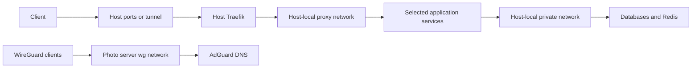

# Docker Compose stacks

[Repository overview](../README.md)

Each host directory contains independent service projects. A typical stack
has a `compose.yml`, an optional `sample.env`, and local configuration or
persistent directories. There is no top-level Compose project that starts
all hosts or services together.

## Hosts

| Host | Responsibility | Deployment coverage |
| --- | --- | --- |
| [Photo server](photo-server/README.md) | On-premises applications, identity, DNS, and storage | SSH through a CI WireGuard connection |
| [Racknerd](racknerd/README.md) | Public services, VPN, mail, and backup storage | Direct SSH from CI |
| [Synology](synology/README.md) | Beszel NAS monitoring | Manual; excluded from deployment and image smoke-test paths |

## Networking



Arrows show typical traffic paths. `proxy` and `private` are external
Docker networks shared between projects **on the same host**. Identical
names on different hosts do not connect them. External networks must exist
before a stack starts; Compose does not create them. Several declarations
label `private` as internal, but the actual pre-existing network determines
its isolation and addressing.

Photo server also uses `wg`, AIO-related networks, and a Tailscale sidecar.
Some services use host networking or project-local networks. Read the
host guide and exact Compose file before changing connectivity.

## Configure and validate a stack

Run commands below from the repository root on the intended host. Inspect
`env_file`, interpolation variables, bind mounts, devices, capabilities,
and external network declarations first. Where supplied, use `sample.env`
as a starting point for a host-local `.env`; some stacks require an `.env`
without supplying a sample. Obtain missing values from the approved secret
store or operator.

```bash
docker compose -f docker/racknerd/api/compose.yml config --quiet
docker network inspect proxy private
```

Relative bind mounts resolve from the Compose file's directory. Ensure
absolute mounts and required files exist with the correct ownership.
`config --quiet` validates configuration without printing resolved secret
values. It does not prove that remote services or bind-mounted files work.
Use the [image smoke checks](../tests/README.md) for image changes.

After validation and with deployment authorization, a typical update is:

```bash
docker compose -f docker/racknerd/api/compose.yml up -d
docker compose -f docker/racknerd/api/compose.yml ps
docker compose -f docker/racknerd/api/compose.yml logs --tail=100
```

## Automated deployment

[deploy.yml](../.github/workflows/deploy.yml) runs on closed PRs targeting
`main` when a Racknerd or photo server `compose.yml` matches. It uses
[scripts/diffs.sh](../scripts/diffs.sh) to select changed Compose files,
fetches SSH/VPN credentials from Infisical, resets the remote checkout to
`origin/main`, pulls, and recreates selected stacks. It then prunes unused
images and Docker resources. The remote reset discards tracked host edits.

The workflow does not explicitly check `pull_request.merged`. Changes only
to environment samples, scripts, or mounted config do not trigger it;
Synology is excluded. See the [automation guide](../.github/README.md) for
these boundaries before relying on an automatic rollout.

## Persistence and recovery

Keep local `.env`, database data, uploads, keys, certificate stores, and
named volumes out of Git. Back up the persistent paths declared by the
stack, including application-managed volumes such as Nextcloud AIO.
A Git revert restores configuration, not a database or schema migration.
Review application-specific recovery steps before downgrading images.

Some stacks contain backup scripts, but their presence does not establish
that a schedule or restore test exists. Host guides identify these scripts
and important storage dependencies.

**Maintenance:** every Docker change requires reviewing this overview,
the affected host inventory, and related runbooks and diagrams. Follow
[the documentation checklist](../docs/documentation.md) in the same change.
