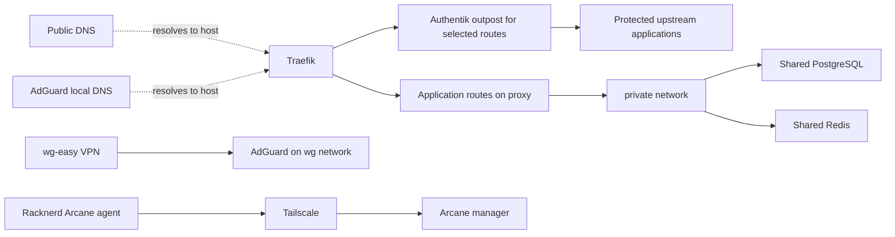

# Photo server

[Docker overview](../README.md) · [Repository overview](../../README.md)

This host runs the on-premises application collection: photos, files,
identity, secrets, databases, DNS, VPN, monitoring, and management tools.
Each linked Compose file is an independent project and the source of truth
for image versions, ports, mounts, and environment requirements.

## Stack inventory

| Stack | Purpose and important dependencies |
| --- | --- |
| [adguard](adguard/compose.yml) | DNS filtering and rewrites; direct TCP/UDP 53 and static addresses on `wg`. |
| [airflow](airflow/compose.yml) | API server, DAG processor, scheduler, triggerer, initializer, and log cleanup. |
| [arcane](arcane/compose.yml) | Docker management UI sharing its Tailscale sidecar network namespace. |
| [authentik](authentik/compose.yml) | Identity server and background worker; database settings come from `.env`. |
| [beszel](beszel/compose.yml) | Monitoring hub and local agent; private agent network and photo disk metrics. |
| [bitwarden](bitwarden/compose.yml) | Bitwarden Lite vault with persistent `data/`. |
| [bsn](bsn/compose.yml) | Social notification worker with local data and logs. |
| [forgejo](forgejo/compose.yml) | Git hosting with persistent `data/`; users and mirrors managed under `tf/forgejo`. |
| [immich](immich/compose.yml) | Photo server, machine learning, dedicated vector-enabled PostgreSQL, and shared Redis. |
| [infisical](infisical/compose.yml) | Secret management backend using shared Redis and environment-provided database settings. |
| [jellyfin](jellyfin/compose.yml) | Media service on host networking; library mounted from `/mnt/media`. |
| [mariadb](mariadb/compose.yml) | Shared MariaDB and phpMyAdmin. |
| [mend](mend/compose.yml) | Mend Renovate Community Edition with local config, logs, and certificates. |
| [meta-mcp](meta-mcp/compose.yml) | MetaMCP gateway with shared database connectivity and a named uv cache. |
| [nextcloud](nextcloud/compose.yml) | Nextcloud AIO master container, which manages additional application containers. |
| [paperless](paperless/compose.yml) | Document management and Nextcloud sync helper; archive and FUSE access. |
| [postgres](postgres/compose.yml) | Shared PostgreSQL, pgAdmin, and Databasus backup UI. |
| [pve-ups](pve-ups/compose.yml) | UPS management UI with named configuration and data volumes. |
| [redis](redis/compose.yml) | Shared Redis with persistent local data on the `private` network. |
| [syncthing](syncthing/compose.yml) | File synchronization with photo, backup, and stack directories mounted. |
| [traefik](traefik/compose.yml) | Reverse proxy, TLS certificates, file routes, DNS-over-TLS and Minecraft entrypoints. |
| [unifi-mcp](unifi-mcp/compose.yml) | UniFi MCP server on project-local bridge and shared private networks. |
| [unifi-toolkit](unifi-toolkit/compose.yml) | UniFi tools routed through the Authentik outpost; SQLite data directory. |
| [uptime-kuma](uptime-kuma/compose.yml) | Local service monitoring, persistent data, and Docker socket access. |
| [wg-easy](wg-easy/compose.yml) | WireGuard VPN with persistent configuration; UDP 51822 and AdGuard DNS. |

## Access and shared services



Dashed arrows show DNS resolution; solid arrows show traffic. The diagram
does not imply startup order or universal authentication rules.
Public DNS is configured in [Cloudflare](../../tf/cloudflare/README.md);
local rewrites in [AdGuard](../../tf/adguard/README.md) direct the local
wildcard to this host. Traefik combines container labels with
[file routes](traefik/config/conf/), including routes to external devices
such as Proxmox, UniFi, Synology, and Home Assistant. Those devices are not
all Docker services on this host.

Selected admin routes point to `authentik-outpost@file`. See
[the outpost config](traefik/config/conf/authentik-outpost.yml) and
[the identity resources](../../tf/authentik/README.md). Do not assume every
Traefik route uses the outpost.

## Host prerequisites

Read [the host setup notes](setup.md) and
[the shared Docker guide](../README.md) before bootstrapping.

- Provide external `proxy` and `private` networks. Traefik also declares
  external `nextcloud` and `bitwarden` networks. Inspect their
  existing runtime configuration before recreating them.
- Provide the external `wg` network with addressing that accommodates
  wg-easy and AdGuard's fixed IPv4/IPv6 addresses. The wg-easy file refers
  to a `setup.md` that is not present in its directory; fixed addressing
  is currently specified in its Compose file.
- Mount `/mnt/photos`, `/mnt/media`, and `/mnt/backup` before starting
  services that use them. Avoid letting a missing disk mount become an
  empty host directory used as application storage.
- Supply per-stack `.env` files and required bind-mounted config. Samples
  are starting points; stacks without samples still need their declared
  environment files. `immich/healthcheck.js` is referenced but not supplied
  by the repository; check that host-local file before rollout.
- Check Docker socket paths against the host's rootless/rootful setup.
  Several management and monitoring stacks mount `/var/run/docker.sock`.

## Operational details

Immich keeps its own vector-enabled PostgreSQL database and photo uploads
under `/mnt/photos`; it is separate from the shared `postgres` project.
Redis is shared by several applications, so a restart has effects beyond
one stack. Cross-project services are not ordered by Compose `depends_on`;
start required networks and backing services before their consumers.

Nextcloud AIO creates additional containers and stores master configuration
in `nextcloud_aio_mastercontainer`. Its generated containers and volumes
are not exhaustively listed in the Compose file. Traefik file routes
connect to the AIO Apache and master containers.

Jellyfin uses host networking for discovery and routes through
`host.docker.internal:8096`; verify that name resolves on the target host.
Syncthing additionally publishes TCP 8384 directly. Traefik publishes
80/443, TCP 853, and TCP 25565; published ports alone do not prove the
corresponding upstream service is configured or reachable.

Mend loads its checked-in [config.js](mend/config.js) through a read-only
bind mount. Review its environment requirements together with the stack.

## Validate and deploy

From the repository root, with host-local environment files available:

```bash
docker compose -f docker/photo-server/immich/compose.yml config --quiet
FILES=docker/photo-server/immich/compose.yml uv run pytest tests/test_containers.py
```

[Deployment CI](../../.github/README.md) connects through WireGuard before
SSH. Only changed `compose.yml` files are selected; changes to mounted
Traefik routes or other config alone need a deliberate rollout. After an
authorized deployment, inspect `ps`, logs, and application health through
the intended ingress route.

## Persistence and runbooks

Back up the declared bind mounts and named volumes, including databases,
photos, Nextcloud volumes, vault data, identity media, and VPN/Tailscale
state. [PostgreSQL backup](postgres/backup.sh) and
[Uptime Kuma backup](uptime-kuma/backup.sh) scripts retain matching dump
files for 14 days; no scheduler is defined by these scripts. The PostgreSQL
script also truncates an Authentik messaging table before dumping.

- [Immich setup](immich/setup.md)
- [Airflow troubleshooting](airflow/issues.md)
- [Nextcloud troubleshooting](nextcloud/issues.md) and
  [Talk bot setup](nextcloud/nextcloud-bot-setup.md)
- [PostgreSQL troubleshooting](postgres/issues.md)
- [Syncthing troubleshooting](syncthing/issues.md)
- [UPS notes](../../docs/ups.md)

**Maintenance:** update this inventory, dependencies, diagram, storage
notes, and affected runbooks with each relevant change. Review related
OpenTofu DNS, identity, and monitor resources using
[the documentation checklist](../../docs/documentation.md).
