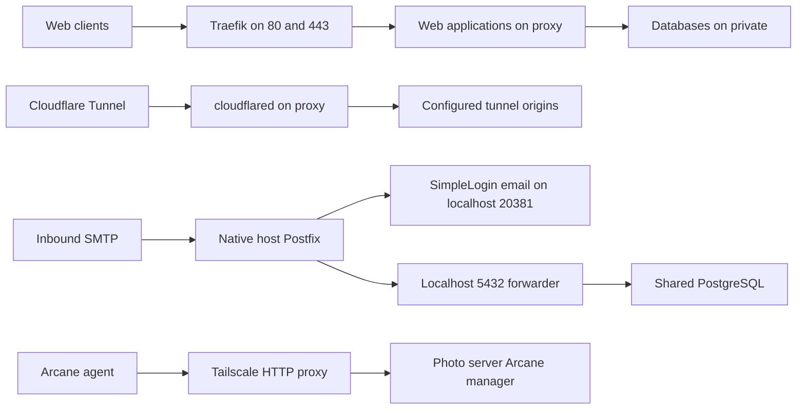

# Racknerd

[Docker overview](../README.md) · [Repository overview](../../README.md)

This public host runs edge services, mail aliasing, API integrations,
monitoring, VPN, and backup synchronization. Each stack is deployed as its
own Compose project; exact versions and mounts live in the linked files.

## Stack inventory

| Stack | Purpose and important dependencies |
| --- | --- |
| [airflow](airflow/compose.yml) | Public Airflow stack with API server, scheduling, DAG processing, and log cleanup. |
| [api](api/compose.yml) | Custom API used by integrations, including infrastructure IP discovery and webhooks. |
| [arcane-agent](arcane-agent/compose.yml) | Docker management agent polling the photo server manager through Tailscale. |
| [beszel](beszel/compose.yml) | Host monitoring agent; TCP 45876 published on all IPv4 interfaces. |
| [cloudflared](cloudflared/compose.yml) | Cloudflare Tunnel connector; runtime token/settings supplied through `.env`. |
| [mariadb](mariadb/compose.yml) | Shared MariaDB and phpMyAdmin. |
| [postgres](postgres/compose.yml) | Shared PostgreSQL, pgAdmin, and Databasus backup UI. |
| [redis](redis/compose.yml) | Shared Redis with local persistence on the `private` network. |
| [simple-login](simple-login/compose.yml) | Email alias application, workers, tools, and localhost PostgreSQL forwarder. |
| [syncthing](syncthing/compose.yml) | Backup synchronization with `/mnt/backup` and stack directories mounted. |
| [traefik](traefik/compose.yml) | HTTP/HTTPS ingress, Docker routing, file configuration, and TLS certificates. |
| [uptime-kuma](uptime-kuma/compose.yml) | Public monitoring instance with Docker socket access and persistent data. |
| [wireguard](wireguard/compose.yml) | WireGuard VPN server; UDP 51820, peer configs, and kernel capabilities. |

## Traffic and cross-host management



Arrows show traffic. [Cloudflare resources](../../tf/cloudflare/README.md)
configure DNS, tunnel origins, and Zero Trust settings. Tunnel traffic
follows those configured origins; it is not necessarily routed through
Traefik. [Tailscale policy](../../tf/tailscale/README.md) permits the
Arcane agent to reach its manager on TCP 3552.

## Host prerequisites

Use [the Debian setup notes](setup.md) for host preparation. Provide the
external `proxy` and `private` Docker networks and required `.env` files.
The setup guide describes rootless Docker, while several stacks expect
`/var/run/docker.sock` or kernel capabilities; verify these against the
actual host before starting them.

Mount `/mnt/backup` for Syncthing, provision stack data directories, and
preserve the UID/GID and ownership expected by each application. Start
backing databases and Redis before consumers that use them across projects;
Compose does not order independent projects.

## SimpleLogin and host mail

[The mail runbook](simple-login/setup.md) covers native Postfix, DKIM,
DNS, database configuration, and explicit initialization/migration tools.
Postfix is a host service, not a Compose service. The SimpleLogin bridge
uses a fixed `10.0.0.0/24` subnet and `10.0.0.1` gateway referenced by the
[Postfix configuration](simple-login/postfix/main.cf).

The email handler is published only at `127.0.0.1:20381`. A Socat forwarder
publishes PostgreSQL at `127.0.0.1:5432` for native Postfix lookups. Keep
these bindings and transport maps aligned. `init` and `migration` use the
`tools` profile and do not run during an ordinary `up`.

## Validate, deploy, and recover

With environment files supplied, run from the repository root:

```bash
docker compose -f docker/racknerd/api/compose.yml config --quiet
FILES=docker/racknerd/api/compose.yml uv run pytest tests/test_containers.py
```

[Deployment CI](../../.github/README.md) uses direct SSH and recreates only
selected changed Compose projects. Host Postfix changes, mounted configs,
and `.env` provisioning need separate rollout steps. Verify both HTTP
health and any affected mail, VPN, or sync path after deployment.

WireGuard publishes UDP 51820. Beszel publishes TCP 45876; confirm intended
firewall and VPN reachability. Syncthing's Compose file mounts backup and
stack directories but does not publish synchronization transport ports;
check runtime connectivity rather than assuming those ports are exposed.

Back up PostgreSQL, MariaDB, application data, mail keys, WireGuard configs,
and Tailscale state. [The Uptime Kuma backup script](uptime-kuma/backup.sh)
dumps SQLite and deletes matching dumps older than 14 days; scheduling is
external to that script. Databasus state lives in the `postgres` stack's
`databasus-data/` directory. Restore procedures must account for database
compatibility as well as image and configuration rollback.

See [Syncthing troubleshooting](syncthing/issues.md) for existing notes.

**Maintenance:** update the inventory, traffic diagram, host dependencies,
and mail/setup runbooks with every relevant change. Review related
OpenTofu and automation guides using
[the documentation checklist](../../docs/documentation.md).
