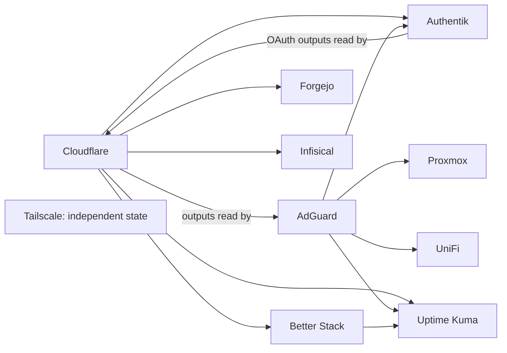

# OpenTofu infrastructure

[Repository overview](../README.md)

This directory contains independent OpenTofu root configurations, mostly
in `.tofu` files. Each provider directory has its own HTTP backend and
provider credentials. Databasus currently contains documentation only.
The active roots have separate states, not child modules in a
single root configuration. Use the version pinned in
[.opentofu-version](.opentofu-version); provider constraints live in each
`provider.tofu` and dependency selections in `.terraform.lock.hcl`.

## Provider areas

| Root | Managed configuration |
| --- | --- |
| [AdGuard](adguard/README.md) | DNS server settings, clients, local rewrites, and filtering rules |
| [Authentik](authentik/README.md) | Users, groups, applications, OAuth/proxy providers, and outpost |
| [Better Stack](better-stack/README.md) | External uptime checks and local-monitor heartbeat |
| [Cloudflare](cloudflare/README.md) | DNS, dynamic address lookups, tunnels, and Zero Trust |
| [Databasus](databasus/README.md) | Documentation only; no OpenTofu configuration in this checkout |
| [Forgejo](forgejo/README.md) | User accounts and mirrored repositories |
| [Infisical](infisical/README.md) | Secret-manager projects, environments, identities, and OIDC grants |
| [Proxmox](proxmox/README.md) | Debian, Windows, and Home Assistant virtual machines |
| [Tailscale](tailscale/README.md) | Tailnet access policy and Arcane device tags |
| [UniFi](unifi/README.md) | Networks, Wi-Fi, firewall zones/policies, VPN, and forwarding |
| [Uptime Kuma](uptime-kuma/README.md) | Local/public monitoring, notifications, groups, and maintenance |

A provider configuration does not install its backing application. Docker
services, API endpoints, initial credentials, and state access must already
exist where required. There is no separate Nix tree or Home Assistant
provider root in the current checkout; Home Assistant VM configuration is
under Proxmox.

## State relationships



Every arrow points from a state whose outputs are read to its consumer.
This is **not an apply-order diagram**: Cloudflare and Authentik read each
other's state, and AdGuard also participates through their dependencies.
A fresh installation needs an explicit bootstrap plan and existing state
outputs; applying all roots alphabetically will not resolve the cycle.
Remote-state reads use the GitLab HTTP endpoints in `provider.tofu`.
Changing an output requires reviewing all consumers, even if their files
did not change and their CI jobs would therefore not run.

## Local workflow

Run format checks from the repository root:

```bash
tofu fmt -check -diff -recursive tf/
```

For a single root, first provision `TF_ADDRESS`, `TF_USERNAME`, and
`TF_PASSWORD` for that root's HTTP state backend. Set the declared inputs
as `TF_VAR_<variable_name>` through the approved secret mechanism. Most
roots also need `TF_VAR_gitlab_username` and
`TF_VAR_gitlab_access_token` to read other states; backend credentials do
not automatically populate input variables.

Then work inside that root, for example:

```bash
cd tf/adguard
bash ../init.sh
tofu validate
tofu plan -out=tfplan
```

[init.sh](init.sh) configures the HTTP address and `/lock` endpoints,
POST/DELETE locking, and a five-second retry wait. It uses `-reconfigure`
and `-upgrade`, so initialization can update provider selections; review
lockfile changes. Do not run it with missing variables: its defaults are
placeholder strings. [install.sh](install.sh) downloads and runs the
OpenTofu installer; it is separate from initialization.

`tofu plan` reads live APIs and remote states and can place sensitive data
in the saved plan. Keep generated plans, state, `.terraform/`, and secret
inputs out of commits. Inspect the plan and apply it only as part of an
authorized rollout. Restore state or infrastructure using an explicit
recovery procedure; reverting HCL alone does not restore deleted data.

## Continuous integration

[tf-state.yml](../.github/workflows/tf-state.yml) detects changed roots,
checks formatting, retrieves each environment's secrets from Infisical,
initializes, validates, and plans. It applies saved plans on pushes to
`main`; PR jobs plan without applying. Provider jobs serialize by root,
but do not order themselves by remote-state dependencies.

Current coverage exceptions:

- Databasus has no change filter or provider job, and no matching
  OpenTofu Infisical environment/OIDC subject or active root configuration
  in the checked-in resources.
- The Tailscale filter matches `tf/tailcale/**`, rather than
  `tf/tailscale/**`. A Tailscale-only change can miss its job. Changes to
  the shared version file or workflow still match that filter.
- Changes to a provider README are within `tf/<provider>/**` filters and
  can trigger that provider's plan, and its apply job on a push to `main`.
- Proxmox, UniFi, and Uptime Kuma jobs set up WireGuard for private API
  access. Other local endpoints still require reachable DNS and routing.

See [the automation guide](../.github/README.md) for the full trigger map.

## Reference and drift audit

The October 2026 audit reviewed all ten active roots and compared live
configuration through UniFi, Proxmox, and Uptime Kuma MCP tools.
Authentik defaults and Infisical organization ownership
use data sources; existing AdGuard host records feed monitoring through
the new `host_records` output. Uptime Kuma retains temporary defaults until
that output is published through a reviewed AdGuard apply. AdGuard-native
TLS is disabled to match Traefik termination; a narrow lifecycle ignore
suppresses the provider's empty-allowlist normalization difference. This
audit does not apply infrastructure changes or update persisted state.

Provider plans for Authentik, Infisical, and UniFi showed no changes;
AdGuard's follow-up plan showed only the new output. All 171 Uptime Kuma
monitors matched the MCP fields compared. Targeted plans for the three
changed local monitors showed no changes against both current state and
a temporary preview of the new output. A full Uptime Kuma preview plan
timed out logging into the public instance, so repeat it before rollout.
Better Stack, Forgejo, and Tailscale had no applicable MCP connection;
their live equivalence was not established.

Review Cloudflare policy ownership before merging to `main`: its plan
would reset automation-written DNS comments and remove additional Chicago
IPv4/IPv6 entries from the internal-IP bypass policy. CI automatically
applies changed roots on main. Proxmox also has existing boot/CD drift:
Debian and Windows boot directly from disk without the installer CDs
still declared here. Windows has an untracked TPM volume, Debian has a
GPU hook script outside the provider schema, and Home Assistant state
contains a stale unused-disk entry. These findings were not reconciled
with live infrastructure by this audit.

The subsequent Compose inventory review removes OpenSpeedTest and
Minecraft/Crafty identity, DNS, Access, and monitoring resources, along
with their memberships, maintenance references, and retired DNS outputs.
The local WireGuard container monitor targets `wg-easy`; Racknerd retains
its `wireguard` target. Airflow's development identity setup remains
configured. These are configuration changes until an authorized apply;
the earlier live-monitor counts above describe the pre-cleanup audit.
Full cleanup plans completed for Authentik, Cloudflare, and Uptime Kuma:
they propose seven, four, and seven deletions respectively, plus the
related membership and monitor-target updates. Cloudflare still includes
the four pre-existing updates described above. No cleanup was applied.

**Maintenance:** update the provider index, state diagram, command
prerequisites, and coverage notes whenever their sources change. Update
the affected provider README and output consumers in the same change,
following [the required checklist](../docs/documentation.md).
